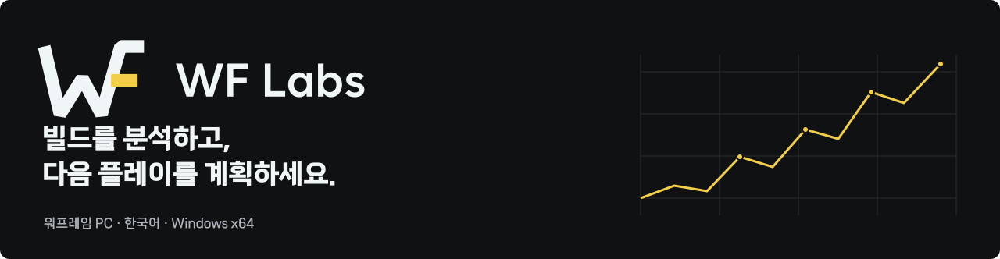
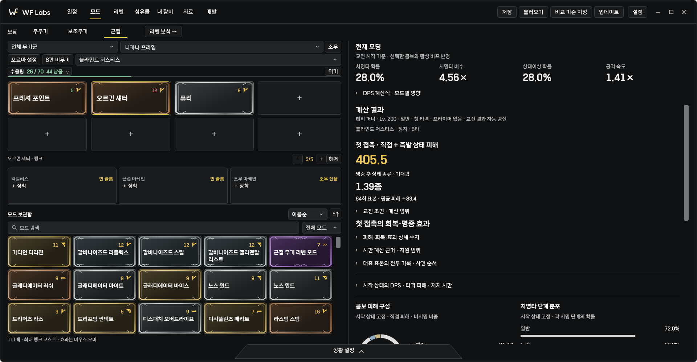
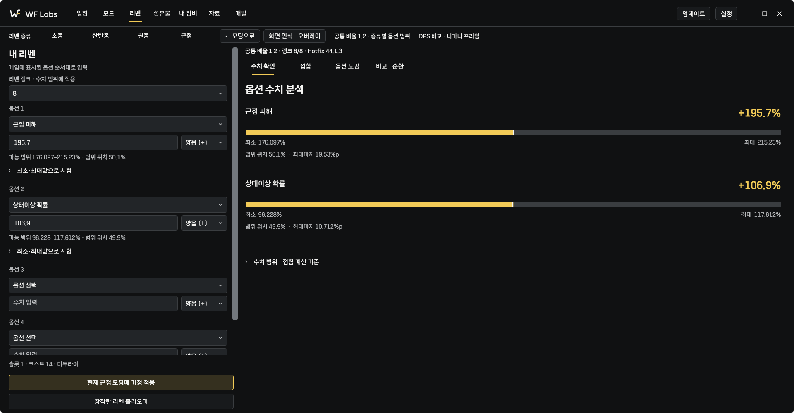
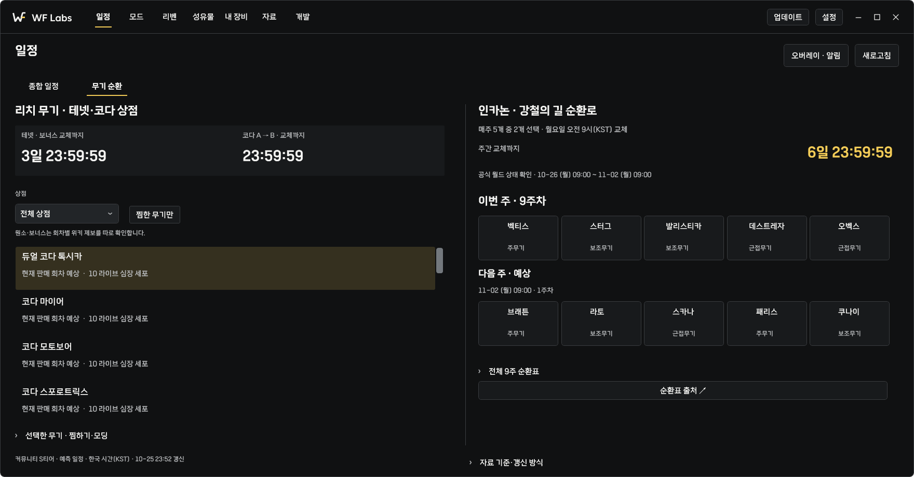

<picture>
  <source media="(prefers-color-scheme: dark)" srcset="docs/assets/github/hero-dark.svg">
  <source media="(prefers-color-scheme: light)" srcset="docs/assets/github/hero-light.svg">
  
</picture>

<p align="center">
  <a href="https://github.com/Revo-32/WF-Labs/releases/tag/v0.10.0-preview.1"><strong>Windows 설치 파일 받기 ↗</strong></a>
  &nbsp; · &nbsp;
  <a href="docs/DISTRIBUTION.md">설치·업데이트</a>
  &nbsp; · &nbsp;
  <a href="https://github.com/Revo-32/WF-Labs/issues">문제 제보</a>
</p>

**WF Labs**는 워프레임 PC 한국어 사용자를 위한 빌드 분석 도구입니다. 모드를 배치하고, 적과 교전 조건을 설정하면 피해량·DPS·TTK를 비교할 수 있습니다. 리벤 분석부터 다음에 할 활동을 고르는 과정까지 한 앱에서 이어갑니다.

> **현재 공개 버전 · 0.10.0-preview.1**<br>
> 한국어 성유물·리벤 OCR, 게임 오버레이, 일정과 마스터리 도우미를 추가한 공개 미리보기입니다. [릴리즈 노트와 설치 파일 보기 →](https://github.com/Revo-32/WF-Labs/releases/tag/v0.10.0-preview.1)

## 모딩에서 비교까지, 한 화면에서

무기를 고르고 모드를 드래그해 배치합니다. 치명타·상태이상 확률은 상단에서 바로 확인하고, 대상과 교전 조건은 하단 **상황 설정**에서 바꿉니다. 자세한 수식·피해 구성·시간에 따른 변화는 계산 결과에서 펼쳐볼 수 있습니다.



<sub>0.10 배포 후보의 실제 앱 렌더링입니다. 예시 빌드와 고정 검수 데이터를 사용했습니다.</sub>

## 필요한 정보를, 필요한 순간에

| 작업 | 확인할 수 있는 정보 |
| :--- | :--- |
| **모드 · 피해 비교** | 주무기·보조무기·근접 모딩, 적·레벨·방어층, DPS·TTK, 빌드 A/B 비교와 계산 근거 |
| **리벤 · 접합과 순환** | 종류별 옵션 범위·수율, 접합 후보, 순환·쿠바 예산과 현재 빌드의 DPS·TTK 비교 |
| **성유물 · 보상 선택** <sup>0.10</sup> | 한국어 보상 자동 인식, 플래티넘·두캇 비교, 저장 시세와 오인식 수정 |
| **일정 · 다음 활동** <sup>0.10</sup> | 낮·밤, 중재 유형·팩션 필터, 테넷·코다 상점, 인카논 순환, 일정 오버레이와 알림 |
| **내 장비 · 마스터리 계획** <sup>0.10</sup> | 숙련 진행 그래프, 제작·구매 추천, 획득처·필요 재화, 보유 성유물의 기대값·정련 계획 |

<details>
<summary><strong>리벤 화면 보기</strong> — 옵션이 가능한 범위의 어디에 있는지</summary>



수율과 F~SSS 등급은 **가능한 수치 범위 내 품질**을 뜻합니다. 획득 확률이나 DPS 점수와는 구분합니다. 접합 후 새 무작위 옵션은 범위로 표시합니다.

<sub>0.10 배포 후보 · 예시 리벤 입력을 사용한 실제 앱 렌더링.</sub>

</details>

<details>
<summary><strong>무기 순환 화면 보기</strong> — 테넷·코다와 이번 주·다음 주 인카논</summary>



상점 교체와 인카논 순환을 함께 확인합니다. 미래 구성·저장 자료의 예상과 공식 확인 자료는 화면에서 구분합니다. 일정 오버레이는 시계를 고정하고 긴 목록만 천천히 세로로 순환합니다.

<sub>0.10 배포 후보 · 고정 시각·검수용 일정 데이터. 현재 실제 판매 목록을 뜻하지 않습니다.</sub>

</details>

## 설치와 업데이트

1. [공개 릴리즈](https://github.com/Revo-32/WF-Labs/releases/tag/v0.10.0-preview.1)에서 `WFLabs-win-Setup.exe`를 받아 설치합니다. Windows x64용이며 .NET 런타임을 포함합니다. 설치 시 OCR에 필요한 Visual C++ x64 런타임을 확인합니다.
2. 앱 상단 **업데이트**에서 확인·다운로드하고, **설치 후 다시 시작**으로 적용합니다. 작업 중 강제로 재시작하지 않습니다.
3. **설정**에서 자동 업데이트 확인·다운로드, Windows 로그인 시 실행, 워프레임 시작 시 실행을 선택합니다.

Portable 배포본과 자세한 요구 사항은 [설치·업데이트 안내](docs/DISTRIBUTION.md)를 확인하세요. 개발 미리보기이며 설치 파일에는 Authenticode 서명이 없습니다. 준비 중인 릴리즈 초안은 클라이언트 업데이트 목록에 노출되지 않습니다.

## 근거와 한계를 함께 표시합니다

계산에는 모드·버프의 브라켓과 공격별 예외를 구분해 반영합니다. 자료로 확인한 규칙, 사용자 설정, 근사 적용을 결과에서 구분하며 출처와 지원 범위를 확인할 수 있습니다.

- **계산 범위** — [구현 상태](docs/IMPLEMENTATION_STATUS.md) · [총기 근사 모델](docs/RANGED_APPROXIMATIONS.md) · [원문 자료 공백](docs/RANGED_SOURCE_GAPS.md)
- **검증** — [Windows 빌드·UI 검사](https://github.com/Revo-32/WF-Labs/actions/workflows/windows.yml) · [계산·자료 검증 기록](docs/VALIDATION.md)
- **0.10 참고** — 실시간 게임 캡처는 FHD 이상을 대상으로 합니다. OCR은 화면 배율·배경에 따라 실패할 수 있고, 인벤토리 직접 읽기는 시험 지원입니다. 시세에는 저장 시각을 표시합니다. 중재 S티어는 커뮤니티 판단입니다.

<details>
<summary><strong>소스 확인과 개발 환경</strong></summary>

C# · .NET 8 · WPF · Windows x64. 저장소의 `global.json`에 맞는 SDK를 사용합니다.

```powershell
dotnet build WFLabs.sln -c Release
./tools/validate.ps1 -Dotnet (Get-Command dotnet).Source
./tools/package.ps1 -Dotnet (Get-Command dotnet).Source
```

전체 검증에는 별도 Windows 데스크톱에서의 실제 WPF 렌더링·상호작용 검사가 포함됩니다. 물리 모니터 이동이나 실제 게임 병행 검수를 대신하지는 않습니다.

[과거 개발 기록](docs/history/README_LEGACY_2026-10-26.md) · [UX 원칙](docs/UX_PRINCIPLES.md)

</details>

---

WF Labs는 커뮤니티가 만드는 비공식 도구입니다. Warframe의 공식 제품이 아닙니다.<br>
자체 소스는 **공개 열람용**이며 별도의 수정·재사용·재배포 라이선스를 부여하지 않았습니다. [소스 공개와 권리](COPYRIGHT.md) · [데이터·폰트·런타임 고지](docs/THIRD_PARTY_NOTICES.txt)
